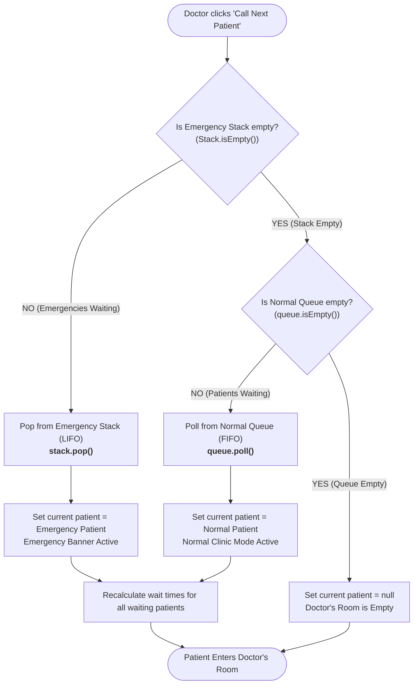
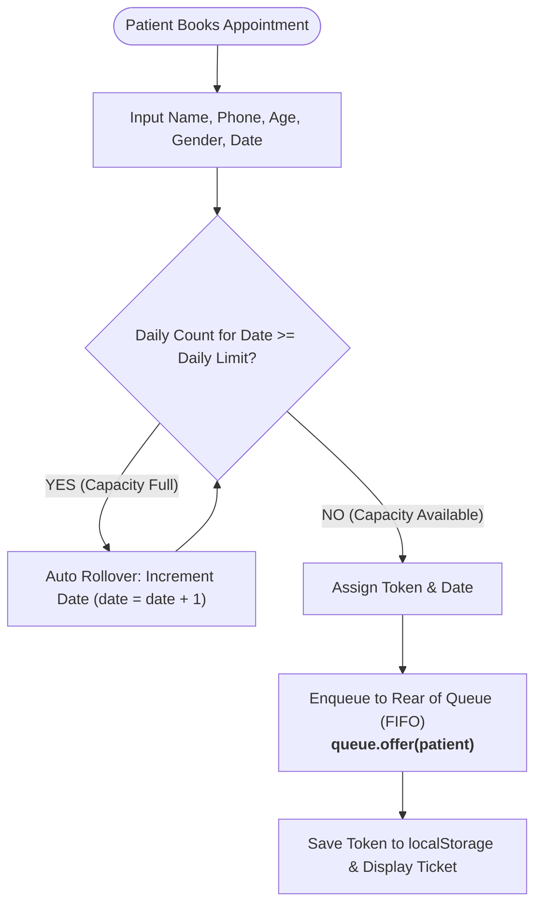
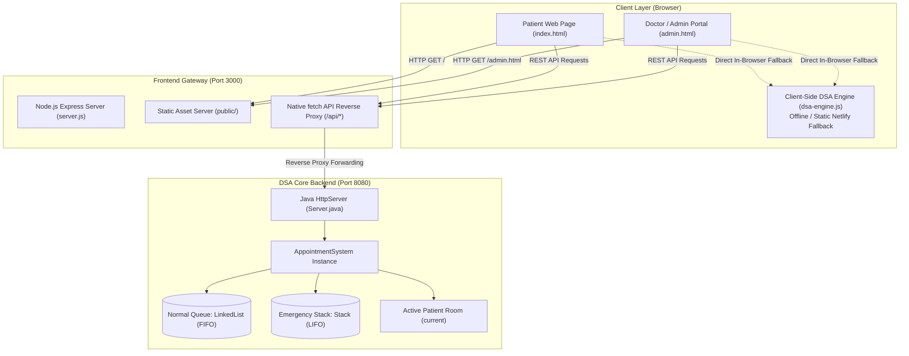
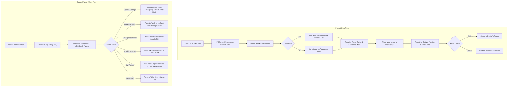
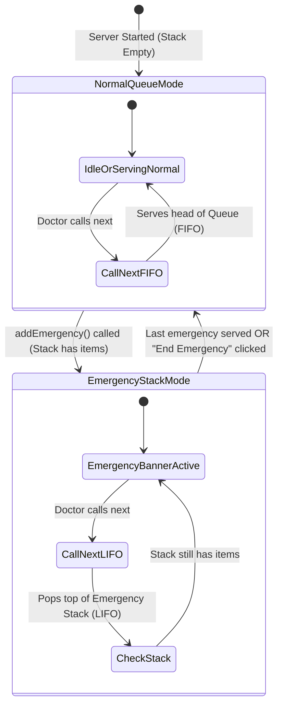
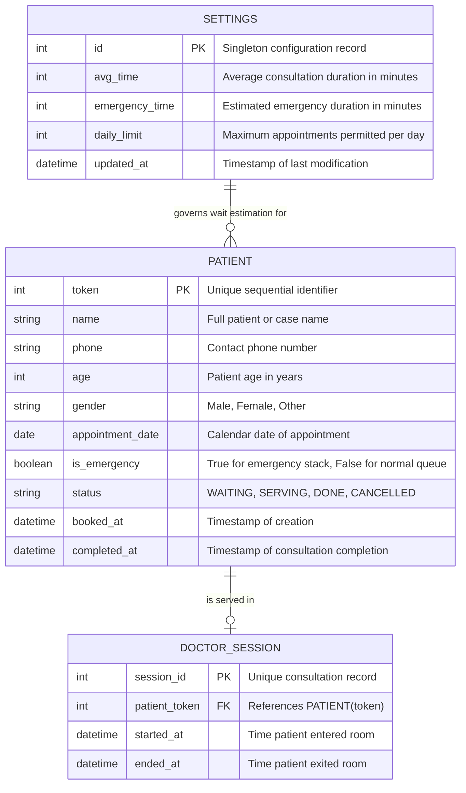

# Doctor Appointment Queue System

A clean, responsive, real-time clinic queue management system built to demonstrate fundamental Data Structures and Algorithms (**Queue (FIFO)** and **Stack (LIFO)**) in a real-world healthcare workflow.

🌐 **Live Application URL:** [https://doctorappointmentqueuesystem.netlify.app](https://doctorappointmentqueuesystem.netlify.app)  
👨‍⚕️ **Doctor / Admin Portal:** [https://doctorappointmentqueuesystem.netlify.app/admin.html](https://doctorappointmentqueuesystem.netlify.app/admin.html) *(Security PIN: `1234`)*


---

## 2. Problem Statement and Why Queue + Stack

In outpatient clinics and hospitals, walk-in patients arrive sequentially and expect fair service in arrival order. A standard **Queue (FIFO - First In, First Out)** guarantees fairness: whoever arrives first is consulted first.

However, medical emergencies frequently occur (such as trauma cases or acute cardiac conditions). Emergency cases cannot wait at the back of a regular queue. When multiple emergencies occur in rapid succession, the most recently arrived acute crisis must often be triaged immediately before older emergencies can stabilize. An **Emergency Stack (LIFO - Last In, First Out)** models this immediate preemption mechanism:
1. **Queue (FIFO):** Regular appointments wait in chronological sequence.
2. **Stack (LIFO):** Critical emergency cases are pushed onto the stack.
3. **Preemption Rule:** The doctor's room always serves the emergency stack first. Only when the emergency stack becomes completely empty does the normal FIFO queue resume.
4. **Dynamic Waiting Time Impact:** Any emergency pushed onto the stack immediately recalculates and extends the estimated wait time for every regular patient waiting in line.
5. **Immediate Emergency Resolution:** When an emergency crisis is resolved, an **End Emergency** action allows the clinic to immediately clear the emergency state and resume regular queue operations.

---

## 3. Features

1. **Appointment Booking with Sequential Tokens & Demographics:** Patients register their name, phone number, age, gender, and select their appointment date via a calendar picker. They receive a numbered token ticket (Token 1, 2, 3...) saved automatically to their browser.
2. **On-Spot Walk-in Registration from Admin Portal:** Doctors and receptionists can book walk-in patients directly on the spot from the admin dashboard with full patient demographics.
3. **Daily Patient Capacity Limit & Automatic Date Rollover:** Admins can configure a daily capacity limit (e.g., 20 patients/day). If the quota for a requested appointment date is full, the system automatically rolls over and schedules the appointment to the next available calendar date.
4. **Live "Now Serving" Consultation Display:** Displays the current active patient or emergency case in the doctor's room with real-time status updates every 3 seconds.
5. **Admin Duration Settings & Dynamic Wait Estimates:** Doctors and administrators can configure average consultation duration per patient (e.g., 10 mins), emergency duration (e.g., 20 mins), and daily capacity limits. Every patient sees their accurate estimated wait time in minutes and approximate clock time.
6. **Emergency Preemption Mode:** When an emergency patient arrives, the clinic transitions into Emergency Mode. The regular queue pauses, waiting times extend, and a high-visibility animated warning banner notifies waiting patients.
7. **End Emergency Mode Control:** Doctors can end Emergency Mode at any time using the one-click **"End Emergency Mode"** button, instantly clearing the emergency stack and resuming normal queue consultations.
8. **Waiting Time Formula with Emergency Extension:**
   $$\text{Wait Time} = (\text{Current Patient Time Remaining}) + (\text{Emergencies in Stack} \times \text{Emergency Time}) + (\text{Queue Position} \times \text{Avg Time})$$
9. **Self-Service Token Cancellation:** Patients can cancel their pending appointment directly from their tracking card, and administrators can cancel tokens from the dashboard queue with instant recalculation.

---

## 4. DSA Concepts & Logic Flow

### Data Structure Operations & Complexity Table

| Operation | Data Structure | Underlying Structure | Time Complexity | Space Complexity | Description |
| :--- | :--- | :--- | :---: | :---: | :--- |
| **Book Appointment** | Queue (FIFO) | `java.util.LinkedList` | **$O(1)$** | $O(1)$ | Enqueues regular patient to the tail |
| **Capacity Rollover Check** | Queue (FIFO) | Array / List Scan | **$O(n)$** | $O(1)$ | Checks date capacity before enqueueing |
| **Add Emergency** | Stack (LIFO) | `java.util.Stack` | **$O(1)$** | $O(1)$ | Pushes emergency case onto the stack top |
| **Call Next (Emergency)** | Stack (LIFO) | `java.util.Stack` | **$O(1)$** | $O(1)$ | Pops the most recent emergency from stack top |
| **Call Next (Normal)** | Queue (FIFO) | `java.util.LinkedList` | **$O(1)$** | $O(1)$ | Polls the head patient from the queue |
| **End Emergency Mode** | Stack (LIFO) | `java.util.Stack` | **$O(1)$** | $O(1)$ | Clears emergency stack and resumes normal queue |
| **Cancel Appointment** | Queue (FIFO) | `java.util.LinkedList` | **$O(n)$** | $O(1)$ | Scans linked nodes to locate token and removes it |
| **Wait Estimate** | Queue + Stack | Iteration / Arithmetic | **$O(n)$** | $O(1)$ | Multiplies stack size and queue index by durations |

---

### Core DSA Decision Logic Flowchart



### Booking & Capacity Rollover Flowchart



---

## 5. System Architecture



---

## 6. User Flow



---

## 7. Emergency Mode State Diagram



---

## 8. Data Model / Logical DBMS Diagram

The current implementation keeps all patient records and waiting lines in memory using Java's standard `Queue` (`LinkedList<Patient>`) and `Stack` (`Stack<Patient>`), paired with the client-side `DSAEngine`. If persistent relational storage (e.g., MySQL, PostgreSQL, SQLite) is integrated in the future, the following ER diagram represents the normalized logical database schema:



---

## 9. API Reference Table

All endpoints communicate via JSON and support cross-origin requests (CORS).

| Endpoint | Method | Request Payload | Response Schema | Description |
| :--- | :---: | :--- | :--- | :--- |
| `/api/book` | `POST` | `{"name":"string", "phone":"string", "age":28, "gender":"Male", "date":"2026-11-22"}` | `{"label":"1", "token":1, "name":"string", "wait":10, "date":"2026-11-22", "rolledOver":false}` | Enqueues a normal patient into the FIFO queue (auto rolls over date if daily capacity is full). |
| `/api/status` | `GET` | *None* | `{"current":{...}, "emergencyMode":bool, "avgTime":10, "emergencyTime":20, "dailyLimit":20, "queue":[...], "emergencies":[...]}` | Returns complete real-time clinic state. |
| `/api/wait` | `GET` | Query param: `?token=N` | `{"found":true, "label":"2", "name":"...", "position":1, "wait":20, "status":"WAITING"}` | Looks up a patient's position and estimated wait. |
| `/api/emergency` | `POST` | `{"name":"string"}` | `{"success":true, "label":"E1", "token":1, "name":"..."}` | Pushes an emergency patient onto the LIFO stack. |
| `/api/emergency/end` | `POST` | *None* | `{"success":true, "emergencyEnded":true, "emergencyMode":false}` | Clears all pending emergencies and instantly ends emergency mode. |
| `/api/next` | `POST` | *None* | `{"success":true, "current":{"label":"...", "token":1, "name":"...", "emergency":bool}}` | Doctor calls next patient (LIFO Stack first, then FIFO Queue). |
| `/api/cancel` | `POST` | `{"token":N}` | `{"success":true}` | Cancels and removes a pending patient from the queue. |
| `/api/settings` | `POST` | `{"avgTime":15, "emergencyTime":25, "dailyLimit":25}` | `{"success":true, "avgTime":15, "emergencyTime":25, "dailyLimit":25}` | Updates consultation duration and daily capacity limit. |

---

## 10. Folder Structure Tree

```
DSA Project/
├── algo/
│   ├── AppointmentSystem.java    # Core Queue & Stack DSA logic with Daily Limit & End Emergency
│   ├── Main.java                 # Console demonstration test suite
│   ├── Patient.java              # Patient entity model (with Age, Gender, Date)
│   └── Server.java               # Built-in Java HttpServer on port 8080 (Zero external libs)
├── frontend/
│   ├── package.json              # Express dependency configuration
│   ├── server.js                 # Express server & API reverse proxy on port 3000
│   └── public/
│       ├── admin.html            # Doctor / Admin dashboard with FIFO, LIFO, & Walk-in Booking
│       ├── dsa-engine.js         # In-browser DSA engine for static Netlify deployment
│       ├── index.html            # Patient portal (Booking, Live Queue, Tracking, Demographics)
│       └── style.css             # Sky Blue & Warm Orange shared theme stylesheet
├── netlify.toml                  # Netlify deployment configuration
├── _redirects                    # Clean URL route redirects
└── README.md                     # Comprehensive project documentation
```

---

## 11. Application Access & How to Run

### 🌐 Live Production Deployment
The application is live and accessible globally:
- **Patient Portal:** [https://doctorappointmentqueuesystem.netlify.app](https://doctorappointmentqueuesystem.netlify.app)
- **Doctor / Admin Portal:** [https://doctorappointmentqueuesystem.netlify.app/admin.html](https://doctorappointmentqueuesystem.netlify.app/admin.html) *(PIN: `1234`)*

---

### 💻 Running Locally

#### Prerequisites
- **Java JDK 17+** (JDK 21 LTS recommended)
- **Node.js 18+** with `npm`

#### Step 1: Start the Java Backend (Port 8080)
Open a terminal in the project root:
```bash
cd algo
javac *.java
java Server
```
You will see:
```text
==================================================
 Doctor Appointment System - Java Backend Running 
 Port: 8080
 Base URL: http://localhost:8080/api/
==================================================
```

#### Step 2: Start the Frontend Gateway (Port 3000)
Open a second terminal in the project root:
```bash
cd frontend
npm install
npm start
```
You will see:
```text
==================================================
 Frontend Server running at: http://localhost:3000
 Patient View:  http://localhost:3000/
 Admin Portal:  http://localhost:3000/admin.html
 Proxying API -> http://localhost:8080
==================================================
```

#### Step 3: Open in Browser
- **Patient Portal:** Open [https://doctorappointmentqueuesystem.netlify.app](https://doctorappointmentqueuesystem.netlify.app) (or `http://localhost:3000`)
- **Doctor / Admin Portal:** Open [https://doctorappointmentqueuesystem.netlify.app/admin.html](https://doctorappointmentqueuesystem.netlify.app/admin.html) (or `http://localhost:3000/admin.html`)
  - Security PIN: `1234`

---

## 12. Sample Test Scenario & Verification

Follow this exact test sequence to verify the Queue and Stack behavior:

1. **Book 3 Normal Patients:**
   - Patient A ("Aarav", 25, Male, Today) $\rightarrow$ Token 1 (Est. wait: 0 min, next in line)
   - Patient B ("Bhavna", 30, Female, Today) $\rightarrow$ Token 2 (Est. wait: 10 min)
   - Patient C ("Chetan", 42, Male, Today) $\rightarrow$ Token 3 (Est. wait: 20 min)
2. **Doctor Calls Next Patient:**
   - Token 1 ("Aarav") enters the room. Now Serving shows **Token 1**.
   - Queue now contains: Token 2, Token 3.
3. **Add 2 Emergency Cases:**
   - Emergency 1 ("Chest Pain Case") $\rightarrow$ Pushed to Stack as **E1**.
   - Emergency 2 ("Accident Case") $\rightarrow$ Pushed to Stack as **E2** (on top of E1).
   - **Notice:** Clinic switches to **Emergency Mode**. Waiting times for Token 2 and 3 instantly jump by +40 minutes ($2 \times 20\text{ min}$).
4. **Doctor Calls Next:**
   - Served: **E2 (Accident Case)** $\rightarrow$ Proves **LIFO** (E2 was added last, but served first).
5. **Test "End Emergency Mode" Button:**
   - Doctor clicks **"End Emergency Mode"**.
   - The remaining emergency (E1) is resolved and cleared. Emergency mode turns off immediately.
6. **Doctor Calls Next:**
   - Served: **Token 2 ("Bhavna")** $\rightarrow$ Normal **FIFO** queue resumes automatically!
7. **Test Daily Limit Rollover:**
   - Set daily limit to 2 patients/day in Settings.
   - Book a 3rd patient for the same date.
   - Notice the ticket displays the warning badge: **Daily Limit Reached - Automatically rescheduled to the next date!**
8. **Cancel Booking Test:**
   - Cancel Token 3. Token 3 is removed from the queue. Doctor's room becomes empty once Token 2 completes.

---

## 13. Future Improvements

1. **Persistent Database Storage:** Migrate in-memory structures to an ACID-compliant database (PostgreSQL / MySQL) with transaction support for crash recovery.
2. **SMS & WhatsApp Notifications:** Integrate Twilio or Fast2SMS to alert patients when their position reaches top 3 in line.
3. **Multi-Doctor & Multi-Specialty Routing:** Expand queues into multiple parallel queues mapped to distinct medical departments (Cardiology, Pediatrics, General Medicine).
4. **Role-Based Authentication:** Replace client-side PIN check with JWT-based authentication and role-based access control (Admin, Receptionist, Doctor).
5. **Real-time WebSockets:** Replace 3-second HTTP polling with WebSocket or Server-Sent Events (SSE) for sub-millisecond push updates.

---

<div align="center">

Made by **Susmit Choudhury** | Reg No: **12517025**  
B.Tech CSE (Data Science & ML), Lovely Professional University

</div>
